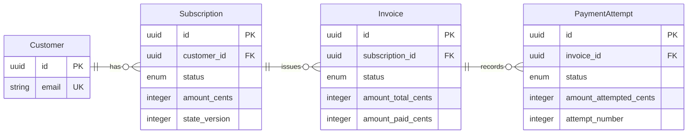
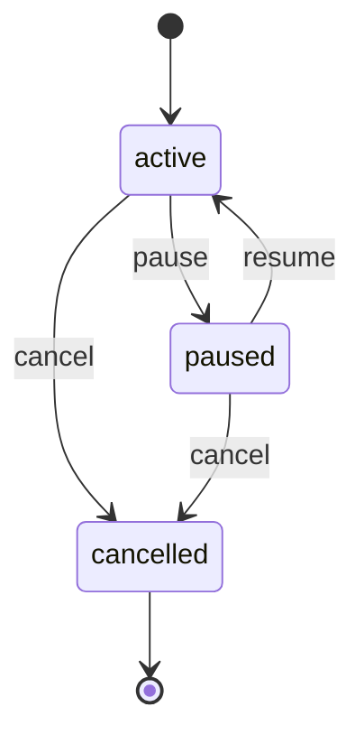
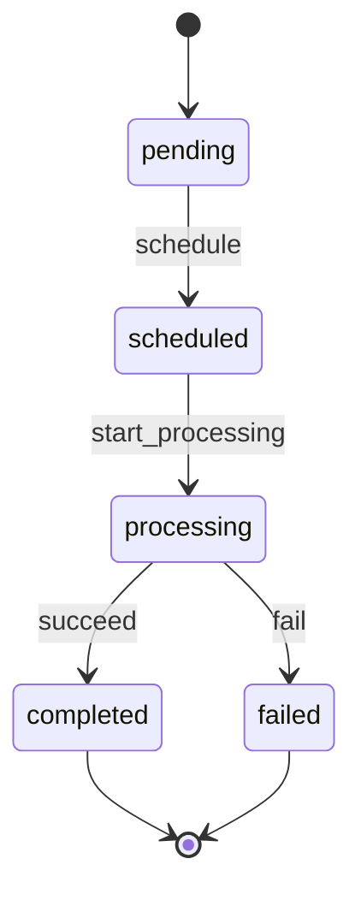
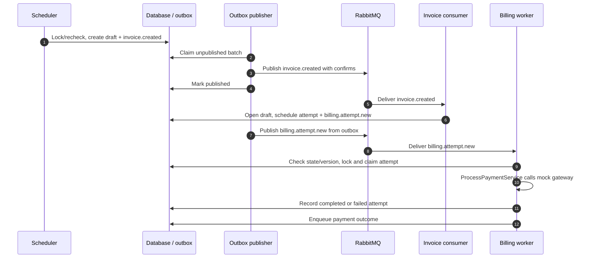
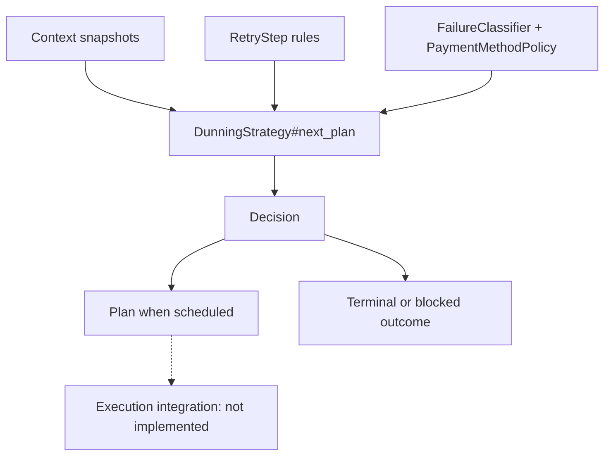

# GuilefulCharger

[](https://github.com/Myuzu/guileful_charger/actions/workflows/ci.yml)

A Rails API prototype for subscription billing: PostgreSQL holds billing state,
a transactional outbox feeds RabbitMQ consumers, and dry-rb objects model
rebilling decisions.

> [!IMPORTANT]
> Charging uses a **mock gateway**. Invoice settlement, retry execution, customer
> notifications, and a billing HTTP API remain unfinished. The only HTTP endpoint
> is the Rails health check, `/up`.

**On this page:** [Quick start](#quick-start) · [Domain objects](#domain-objects) ·
[Billing flow](#billing-flow) · [Rebilling](#rebilling) ·
[Implementation status](#implementation-status) · [Project map](#project-map)

| Guide | What it covers |
| --- | --- |
| [Development](docs/development.md) | Setup, checks, individual specs, and environment cleanup |
| [Rebilling](docs/rebilling.md) | Current planner, algorithm design, integration contract, and roadmap |
| [Type checking](docs/type-checking.md) | Sorbet adoption, dry-rb boundaries, and RBI regeneration |
| [Dependency automation](docs/dependency-automation.md) | Dependabot, the two-stage RBI publisher, and App setup |
| [Operations](docs/operations.md) | Outbox retention, RabbitMQ topology, monitoring, and upgrades |

## Quick start

### Runtime stack

| Component | Repository configuration | Purpose |
| --- | --- | --- |
| Ruby / Bundler | [4.0.9](.ruby-version) / [4.0.23](Gemfile.lock) | Application and dependency tooling |
| Rails | [8.1.x](Gemfile) API mode | Models, services, and health endpoint |
| PostgreSQL | [18.6](.devcontainer/postgres/Dockerfile), `pg_partman`, `pg_cron` | Billing state, outbox partitions, and maintenance |
| RabbitMQ / Hutch | [4.4.0 management image](.devcontainer/compose.yaml) / [Hutch](config/hutch.yaml) | Event transport and consumers |
| Domain libraries | [AASM, MoneyRails, dry-rb](Gemfile) | State machines, cent-based amounts, validation, and results |
| Quality tools | [RSpec, RuboCop, Brakeman, Sorbet, Tapioca](Gemfile) | Behavior, style, security, and gradual typing |

### Local development and testing

Install Docker with Compose and Make. The Makefile invokes the `docker-compose`
command; Ruby and Bundler are only needed on the host for the
[native workflow](docs/development.md#native-ruby-workflow).

```bash
make bootstrap     # Start Rails/PostgreSQL/RabbitMQ containers; install gems
make test          # Prepare the test database and run Rails specs
make check         # Specs, tooling coverage, lint, types, and RBI verification
```

> [!NOTE]
> Compose keeps the Rails container alive with `sleep infinity`. It does not
> launch the web server, Hutch workers, the payment scheduler, or the outbox
> publisher. See [running the prototype](docs/development.md#running-the-prototype)
> for explicit commands.

<details>
<summary>Common commands</summary>

| Task | Command |
| --- | --- |
| List all targets | `make help` |
| Run one spec | `make test RSPEC_ARGS="spec/models/customer_spec.rb --seed 123"` |
| Check isolated tooling coverage | `make test-tooling` |
| Check types / generated interfaces | `make typecheck` / `make rbi-verify` |
| Run lint / security checks | `make lint` / `make security-check` |
| Stop services, keeping data | `make docker-compose-down-test` |

The [development guide](docs/development.md) explains database requirements,
native commands, and the destructive cleanup target.

</details>

## Domain objects

The persisted billing chain is **customer → subscription → invoice → payment
attempt**. Each child belongs to exactly one parent; each parent can have no
children or many. The diagram shows selected fields rather than the full schema.



| Object | Behavior and constraints |
| --- | --- |
| [Customer](app/models/customer.rb) | Unique email; invoices are accessible through subscriptions. |
| [Subscription](app/models/subscription.rb) | Active subscriptions are billable and service-accessible. Invoice creation locks and rechecks the billing period. |
| [Invoice](app/models/invoice.rb) | Unique subscription/billing-period combination. Opening a draft creates its first payment attempt. |
| [PaymentAttempt](app/models/payment_attempt.rb) | Records gateway response, transaction ID, failure reason, and state timestamps. |
| [OutboxMessage](app/models/outbox_message.rb) | Event topic/payload plus publication state. Optional aggregate type/ID/version are metadata, without a foreign key or Active Record association. |

Money is stored in cents. The schema omits currency columns and effectively
assumes one currency. [Migrations](db/migrate) are the schema source of truth;
automatic schema dumps are disabled to preserve extension-managed outbox setup.

### State transitions

The subscription lifecycle makes cancellation terminal:



Pause, resume, and cancel [command services](app/services) validate keyword inputs
and return structured `Success` / `Failure[:code, metadata]` results. They update
the subscription version and enqueue lifecycle events in the same transaction.
Pause removes current-period draft invoices without attempts. Resume extends the
period by the pause duration and re-enqueues scheduled attempts. Cancellation is
terminal; these commands do not refund charges or void open invoices.

<details>
<summary>Payment-attempt transitions and invoice status limits</summary>



Invoice has five declared statuses: `draft`, `open`, `paid`, `partially_paid`,
and `not_paid`. Only **`draft → open`** currently has a transition event.
Completing an attempt does not settle its invoice or advance the subscription
billing period.

</details>

## Billing flow

This sequence shows one processable initial attempt. Each outbox write happens
before a separate publisher invocation sends the event to RabbitMQ. The billing
worker groups `BillingProcessorConsumer` and its `ProcessPaymentService` call.



The entry points are [PaymentScheduler](lib/payment_scheduler.rb),
[InvoiceConsumer](app/consumers/invoice_consumer.rb),
[BillingProcessorConsumer](app/consumers/billing_processor_consumer.rb), and
[ProcessPaymentService](app/services/process_payment_service.rb).

**Delivery is at least once.** Consumers validate message schemas, reload domain
state, and check subscription versions. Draft-only opening and
scheduled-only processing make duplicate deliveries no-ops once state has
advanced. There is no generic processed-message inbox, and the gateway call has
no external idempotency key; exactly-once charging is not guaranteed.

Malformed payloads are ACKed as poison messages. Recording
`billing.consumer.invalid_payload` is best-effort and can fail during a database
outage. Retryable system failures mark the attempt failed and raise for broker
handling; a redelivery is **not** a newly scheduled payment retry. See
[outbox and broker behavior](docs/operations.md) for retention and routing details.

## Rebilling

[Rebilling::DunningStrategy](app/services/rebilling/dunning_strategy.rb) is a
standalone rules-based planner. It computes a decision from snapshots and returns
an optional immutable `Plan`; the billing consumer does not execute those plans.

The [rebilling guide](docs/rebilling.md) covers its objects, decision order,
default steps, and a runnable snapshot example. The original algorithm plan and
gap analysis are integrated as [design](docs/rebilling/algorithm-plan.md) and
[roadmap/research](docs/rebilling/roadmap.md) references, with current status called out.



The default step percentages are **75 → 50 → 25 → 25 → 15 → 10 → 5**. The planner
caps amounts at the remaining balance, calculates retry windows with deterministic
jitter, selects eligible payment methods, classifies failures, and enforces a
default maximum attempt number of **12**. Step success/failure transitions control
whether a step repeats, advances, or stops; this is not an unconditional ladder.

`Rebilling::Context`, `Attempt`, and `PaymentMethodSnapshot` are in-memory inputs;
there is no persisted payment-method model. `DecisionRecorder` is a no-op,
scoring is a placeholder, and `PostExhaustionPolicy` returns an action without
applying it. The older [RebillingStrategy](lib/rebilling_strategy.rb) is an unused
stub. [RetryManagerConsumer](app/consumers/retry_manager_consumer.rb) only logs.

<details>
<summary>Mock gateway outcomes (amounts in cents)</summary>

| Amount | Outcome |
| --- | --- |
| `0` | `system_error` |
| `1–500` | `success` |
| `501–2000` | `insufficient_funds` |
| All other amounts | `failed` |

Source: [PaymentGatewayApiMock](lib/payment_gateway_api_mock.rb).

</details>

## Implementation status

| Area | Present | Remaining work |
| --- | --- | --- |
| Subscription lifecycle | Pause/resume/cancel services, locking, versioned events | User-facing API and broader side effects |
| Initial billing | Draft invoice → scheduled attempt → mock gateway result | Real gateway integration and external idempotency |
| Rebilling | Tested decision planner and retry rules | Persist/execute plans; wire the retry consumer |
| Settlement | Invoice totals, status fields, and remaining-balance helpers | Reconcile successful attempts and advance billing periods |
| Messaging | Transactional outbox, publisher confirms, quorum queues, DLX/TTL topology | Recurring process wiring and end-to-end operational guarantees |
| Notifications / audit | Logging consumers and recorder interfaces | Customer delivery and durable audit history |
| Product model | Customers, subscriptions, invoices, attempts | Payment-method persistence, plans, refunds, taxes, and multi-currency |
| Deployment | Development Compose and a Kamal scaffold | Production hosts, secrets, HA, backup/restore, and recovery setup |

## Dependabot and generated interfaces

Dependabot checks gems and Actions weekly with a seven-day cooldown. An
unprivileged workflow generates RBIs; a separate trusted workflow validates the
artifact and uses a repository-scoped GitHub App token to commit only generated
interfaces. The App commit runs normal CI, and dependency PRs require review.

See the [flow diagram, setup, and recovery guide](docs/dependency-automation.md).
For manual regeneration and runtime-check policy, use the
[type-checking guide](docs/type-checking.md).

## Project map

| Path | Responsibility |
| --- | --- |
| [`app/models/`](app/models) | Persisted billing entities and transitions |
| [`app/services/`](app/services) | Lifecycle commands, gateway processing, outbox publishing, and rebilling objects |
| [`app/consumers/`](app/consumers) | Hutch subscriptions, payload contracts, and duplicate/stale handling |
| [`lib/`](lib) | Scheduler, mock gateway, RabbitMQ topology, and dry-types catalog |
| [`db/migrate/`](db/migrate) | Tables, enums, outbox partitions, and extension maintenance |
| [`spec/`](spec) / [`test/tooling/`](test/tooling) | Rails behavior / isolated automation and compiler coverage |
| [`sorbet/`](sorbet) | Static-check configuration, generated RBIs, and custom Tapioca compiler |
| [`docs/`](docs) | Development/operations guides, rebilling design, and roadmap |
| [`.devcontainer/`](.devcontainer) / [`.github/`](.github) | Local services / CI and dependency automation |

Diagrams use [GitHub's native Mermaid support](https://docs.github.com/en/get-started/writing-on-github/working-with-advanced-formatting/creating-diagrams).
