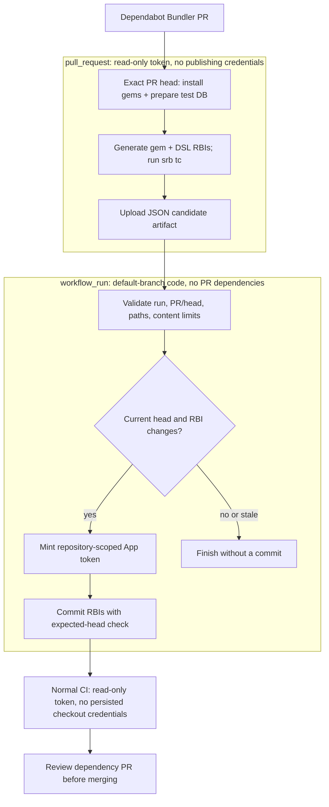

# Dependency automation

[← README](../README.md#dependabot-and-generated-interfaces) · [Type checking](type-checking.md) · [Development](development.md)

## Update policy

[`dependabot.yml`](../.github/dependabot.yml) checks Bundler and GitHub Actions
weekly, with a seven-day release cooldown.
[Security updates bypass the cooldown](https://docs.github.com/en/code-security/reference/supply-chain-security/dependabot-options-reference#cooldown).

| Ecosystem | Grouping |
| --- | --- |
| Bundler minor/patch | First matching group: Sorbet toolchain → dry-rb → catch-all |
| Bundler major | Individual PRs |
| GitHub Actions | One group; commit-SHA pins retain version comments |
| Docker images | No Dependabot update configuration |

## RBI publishing flow

Ruby interface files must follow gem changes. Generation loads PR dependencies;
publishing uses trusted default-branch code and a separately scoped credential.



Source workflows: [generation](../.github/workflows/dependabot-rbi.yml) and
[publisher](../.github/workflows/publish-dependabot-rbi.yml). Validation and commit
logic live in [`script/dependabot_rbi.rb`](../script/dependabot_rbi.rb).

### Generation

- Only same-repository Dependabot Bundler PRs and the Dependabot actor qualify.
- Ordinary updates use incremental `bin/tapioca gems`. Lockfile changes to
  Tapioca, RBI, Rubydex, Spoom, or Sorbet gems force `--all` because reflection
  changes can affect unchanged dependencies. The diff uses the PR merge-base.
- Rails DSL generation uses a disposable test DB through the shared
  [`ci_postgres.sh`](../script/ci_postgres.sh) bootstrap. Generation gates on
  `srb tc`, without repeating the application spec suite.
- Non-RBI metadata such as `.gitattributes` is excluded. Artifact uploads
  overwrite previous candidates for the same head, so re-runs work.

The App's follow-up commit runs normal CI. Generation requires the Dependabot
actor, so the App commit does not start a publishing loop. Generated commit
messages include `[dependabot skip]`, which
[lets Dependabot rebase over extra commits](https://docs.github.com/en/code-security/how-tos/secure-your-supply-chain/manage-your-dependency-security/manage-dependabot-prs#allowing-dependabot-to-rebase-and-force-push-over-extra-commits).
The marker does not skip GitHub Actions CI.

### Publishing boundaries

| Accepted | Rejected |
| --- | --- |
| Regular `.rbi` content under `sorbet/rbi/gems` and `sorbet/rbi/dsl` | Shims, annotations, source/workflow changes, traversal paths, oversized content |
| Valid originating run and current same-repository PR | Forks, unrelated run associations, incomplete PR file listings |
| Atomic branch expected-head match | A concurrent head change; stale/closed PRs skip successfully |

Artifacts download outside the workspace and are treated as data. The publisher
does not check out PR code, install its gems, or execute downloaded content. It
uses Ruby standard libraries and `gh`; the App token is minted only when validated
changes remain. No dependency update is automatically merged.

<details>
<summary>Concurrent close / merge behavior</summary>

Closed/merged PRs and superseded heads skip. A missing branch during mutation is
rechecked against current PR state. Empty workflow-run PR associations are checked
after validating the current PR: stale work skips, but an unassociated current
head is still rejected.

GitHub's commit mutation atomically checks the branch head, not PR open state.
The publisher rechecks state after success and reports an in-flight close as a
skip, including the created commit URL. A retained branch merged in that narrow
window can receive an orphan RBI commit; the already-merged default branch is
unaffected. The publisher does not rewrite branch history to undo it.

</details>

## App setup and rotation

The repository uses a dedicated private GitHub App. For a fresh installation or
credential replacement:

1. Register a private App with webhooks disabled. Grant repository **Contents:
   read/write** and **Pull requests: read**; metadata read is automatic. No OAuth
   callback or webhook server is needed.
2. Install it on **only** `Myuzu/guileful_charger` and generate its private key.
3. Store the client ID as an **Actions repository variable** and the key as an
   **Actions repository secret**, rather than Dependabot secrets:

   ```bash
   gh variable set RBI_APP_CLIENT_ID --repo Myuzu/guileful_charger --body '<App client ID>'
   gh secret set RBI_APP_PRIVATE_KEY --repo Myuzu/guileful_charger < /path/to/private-key.pem
   ```

The publisher must be on the default branch to receive `workflow_run` events.
Missing credentials leave the generation artifact available but fail publication
when changes need committing. Exercise a setup change with a Dependabot Bundler
update, then check generation, publishing, and the App commit's CI. Initial CI
can fail for stale RBIs before the refreshed commit arrives.

## Troubleshooting and recovery

| Symptom | Check |
| --- | --- |
| Generation fails | DB preparation, gem/DSL generation output, and `srb tc` |
| Publisher skips | PR closed/merged, head superseded, or no generated change |
| Publisher rejects artifact | Provenance, permitted paths/size, and complete PR file listing |
| App configuration fails | Actions variable/secret, installation scope, and App permissions |
| App commit fails CI | Treat normal lint, type, interface, and spec failures as merge blockers |

For manual recovery, check out the dependency PR with a prepared test database:

```bash
bin/tapioca gems --all
CI=1 bin/tapioca dsl
bundle exec srb tc
```

Review and commit generated interfaces, then rerun normal CI. Never execute
artifact content as Ruby or apply artifact paths outside the two generated
directories. Publisher regressions run without Rails or a database:

```bash
bundle exec ruby bin/test_tooling automation
```
