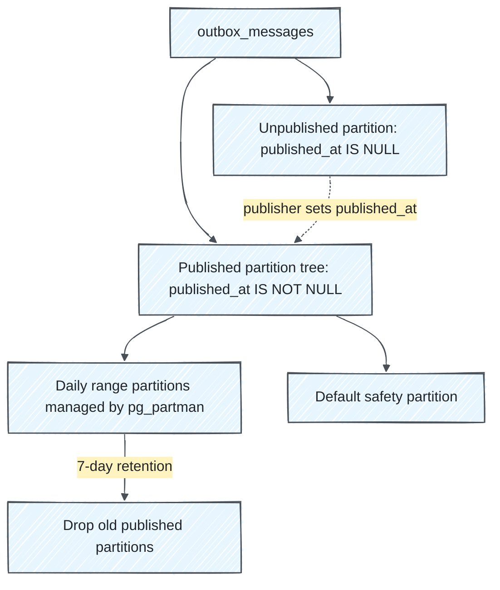
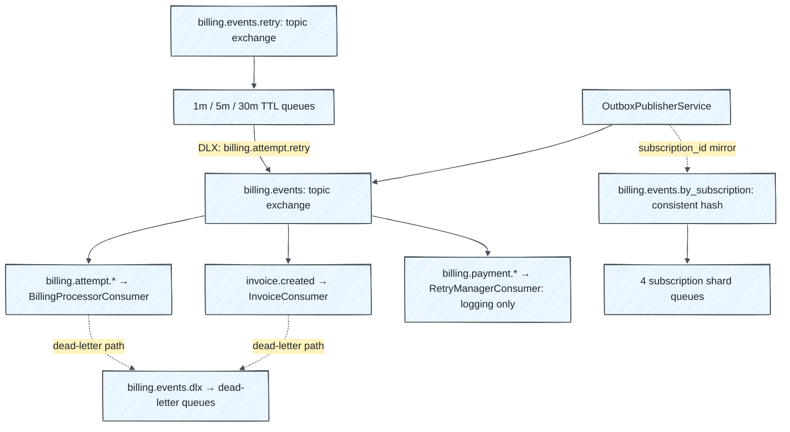

# Operations

[← README](../README.md) · [Development](development.md) · [Dependency automation](dependency-automation.md)

## Outbox storage and retention

The [outbox migration](../db/migrate/20260425140001_create_outbox_messages.rb)
uses PostgreSQL native partitioning to keep unpublished work separate from
published history.



| Concern | Behavior |
| --- | --- |
| Identity / creation time | PostgreSQL `uuidv7()` IDs; creation age comes from `uuid_extract_timestamp(id)`, with no `created_at` column |
| Claiming | [`OutboxPublisherService`](../app/services/outbox_publisher_service.rb) claims batches in ID order using `FOR UPDATE SKIP LOCKED` |
| Publication | Publisher confirms precede `published_at`; a failed publish records attempts/error and clears the claim |
| Stale claims | Lock timeout makes abandoned work claimable again |
| Retention | `pg_partman` drops published partitions after seven days; unpublished rows are never removed by this policy |
| Scheduling | `pg_cron` maintains partitions and reindexes hot-partition indexes; the `pg_partman` background worker is not enabled |

Setting `published_at` moves a row into the published partition tree. Future
partitions are precreated even during idle periods, avoiding repeated final
partition retention warnings. Scheduled reindexing uses plain `REINDEX INDEX`:
the concurrent form cannot run inside pg_cron's transaction wrapper.

Monitor unpublished backlog independently of published retention:

```sql
SELECT COUNT(*) AS unpublished_count,
       MIN(uuid_extract_timestamp(id)) AS oldest_unpublished_at
FROM outbox_messages
WHERE published_at IS NULL;
```

Published history is operational/debug data, not a durable audit log. Export it
elsewhere if long-term retention is required. Migrations own the partition and
extension configuration; schema-only dumps do not preserve `pg_partman` metadata.

## RabbitMQ topology

[`RabbitMqTopology`](../lib/rabbit_mq_topology.rb) declares exchanges and queues;
[`ActiveConsumer`](../app/consumers/active_consumer.rb) supplies the queue DSL.



Consumer queues use quorum queues, manual acknowledgements, prefetch `1`,
delivery limits, dead-letter routing, and single-active-consumer arguments.
Publishing uses durable defaults and confirms. These controls complement domain
state/version checks; delivery can still be duplicate or out of order. The
consistent-hash mirror is best-effort and does not replace primary Hutch routing.

TTL retry queues are declared, but the rebilling planner is not wired to publish
plans into them. `RetryManagerConsumer` only logs. `NotificationConsumer` also
only logs and currently binds `billing.*`: RabbitMQ's `*` matches one segment, so
this does not match multi-segment keys such as `billing.payment.full.success`.

### Plugins and monitoring

The management image bundles `rabbitmq_management`, `rabbitmq_prometheus`, and
`rabbitmq_consistent_hash_exchange`; all upgrade with the broker. There are no
separate plugin downloads. [Compose configuration](../.devcontainer/compose.yaml)
and CI enable the same plugins.

| Endpoint | Purpose |
| --- | --- |
| `http://localhost:15672` | Management UI: administration and queue totals |
| `http://localhost:15692/metrics` | Prometheus metrics |
| `localhost:5672` | AMQP |

The deprecated management metrics collector and detailed statistics are disabled;
use Prometheus instead of management charts. RabbitMQ can still log
`Metrics collection disabled in management agent, management only interface started`
at warning level for this supported setup. CI checks alarms and deprecated-feature
use. See the [management plugin guidance](https://www.rabbitmq.com/docs/management#disable-stats).
The broker has a 60-second stop grace period for quorum queue shutdown.

## Database and broker upgrades

<details>
<summary>PostgreSQL 18.3 → 18.6 and extensions</summary>

The development image extends `postgres:18.6` with PostgreSQL 18 packages for
`pg_partman` and `pg_cron`. PostgreSQL 18+ mounts data at `/var/lib/postgresql`.
Compose preloads `pg_cron` with
`cron.database_name=guileful_charger_development`; migrations create extensions
and schedule maintenance.

This is a minor-version upgrade: back up the database, stop it, rebuild its image,
and restart with the existing volume. Do not delete the volume or perform a
major-version dump/restore solely for this change. Run Rails migrations to update
extension SQL definitions. Extension upgrades are irreversible; rollback requires
a backup. Review the [18.6 release notes](https://www.postgresql.org/docs/release/18.6/)
for extra steps affecting optional features you use.

</details>

<details>
<summary>RabbitMQ 4.3 → 4.4.0 with existing data</summary>

Upgrade to **4.3.7** first and enable all stable feature flags before moving to
4.4.0, following the [4.4.0 release notes](https://github.com/rabbitmq/rabbitmq-server/releases/tag/v4.4.0).
Export definitions and take an offline data-volume backup before replacing the
container. Preserve node name and hostname: quorum queues cannot be restored
under a different node name, and current Compose uses a container-generated
hostname. Fresh environments can start directly with 4.4.0.

Follow the upstream [upgrade](https://www.rabbitmq.com/docs/upgrade) and
[backup](https://www.rabbitmq.com/docs/backup) guides for an existing installation.

</details>

## CI and deployment scope

[`script/ci_postgres.sh`](../script/ci_postgres.sh) reads development Compose with
a [CI override](../.github/ci/postgres.compose.yml) for port publishing and restart
policy. Project `guileful-charger-ci` isolates its containers/volumes from local
development. Re-runs replace that project's DB; failures print the last 200 log
lines before cleanup. Successful runs leave the CI service for subsequent steps.

[`config/deploy.yml`](../config/deploy.yml) is a Kamal scaffold with placeholder
hosts/image names. The tracked configuration does not provide production-grade
PostgreSQL/RabbitMQ HA, secret management, backups, or disaster recovery.
